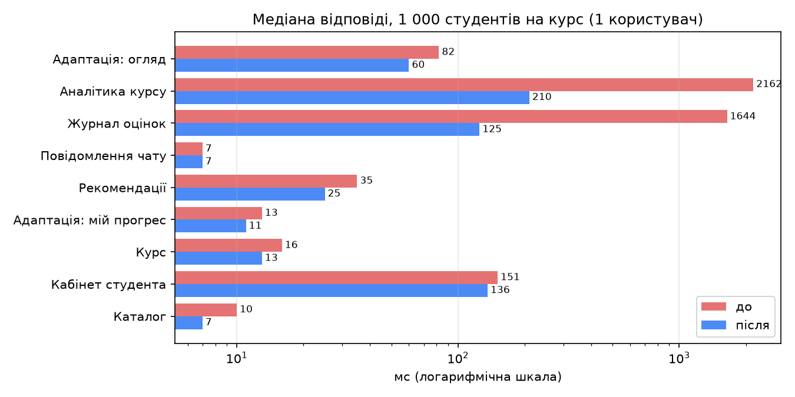
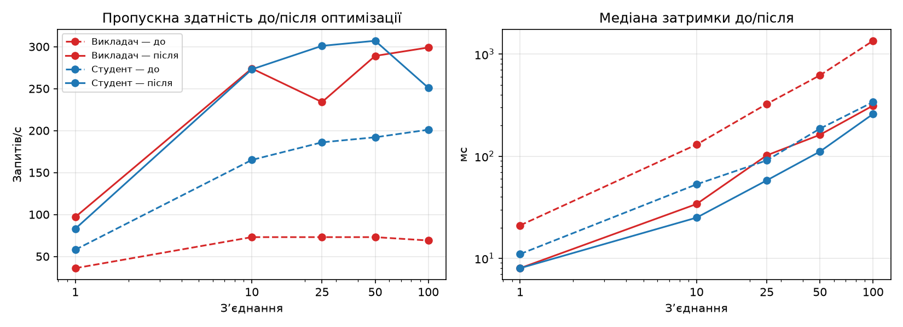
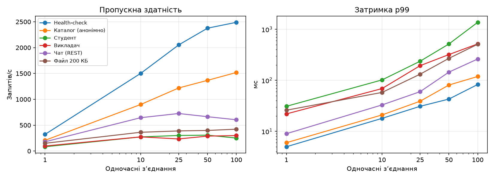
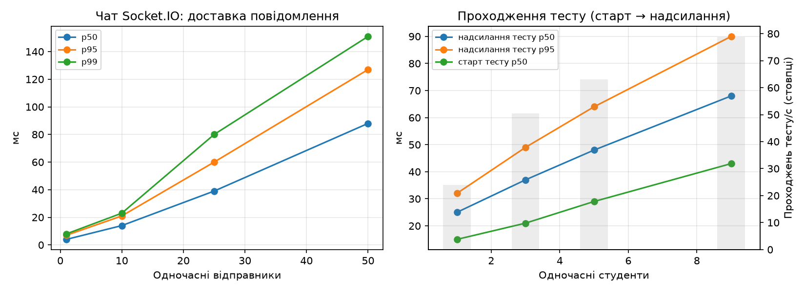
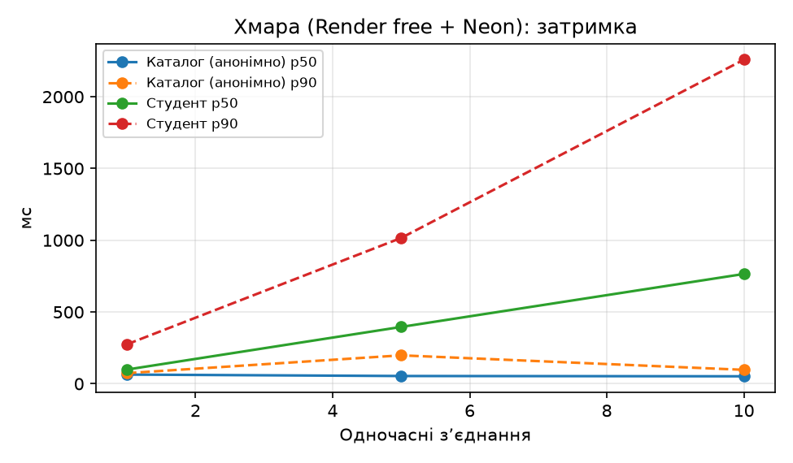

# Оцінювання продуктивності системи

Документ описує методику, середовище та результати навантажувального тестування LMS, аналіз запитів до бази даних і оптимізації, внесені за результатами вимірювань. Матеріал підготовлено для розділу 3 кваліфікаційної роботи (завдання 8 «Провести тестування та оцінити продуктивність системи»). Усі сценарії відтворювані: код — у каталозі `perf/`, сирі результати — у `perf/results/`, графіки — у `docs/performance/`.

## 1. Мета та методика

Мета — визначити пропускну здатність (запитів за секунду, RPS) і затримку відповіді (перцентилі p50, p90, p99) основних сценаріїв роботи за зростання кількості одночасних користувачів, знайти точку насичення та вузькі місця, усунути їх і підтвердити ефект повторним вимірюванням.

Інструменти:

| Інструмент | Призначення |
|---|---|
| autocannon 8 (Node.js) | HTTP-навантаження із заданою кількістю одночасних з’єднань (k6 на macOS 12 через Homebrew вимагає збирання з вихідного коду, тому обрано autocannon) |
| власний скрипт `perf/flow.mjs` | сценарій із записом у БД: старт і надсилання тесту кількома студентами одночасно (з оновленням адаптивної моделі) |
| власний скрипт `perf/socket-latency.mjs` (socket.io-client) | затримка доставки повідомлення чату через Socket.IO |
| `perf/endpoints.mjs` | порівняння «до/після» окремих ендпоінтів |
| Lighthouse 12 (системний Chrome) | продуктивність і якість клієнтської частини (Core Web Vitals) |
| PostgreSQL `EXPLAIN (ANALYZE, BUFFERS)` | плани виконання найважчих запитів |
| CPU-профіль Node.js (`--cpu-prof`) | пошук «гарячих» місць у коді |

Рівні навантаження: 1, 10, 25, 50 і 100 одночасних з’єднань, по 15 с на рівень. Кожне з’єднання виконує запити сценарію по колу без пауз, тобто 100 з’єднань відповідають значно більшій кількості реальних користувачів, які між діями читають сторінку.

Сценарії:

| Код | Сценарій | Запити |
|---|---|---|
| health | базова лінія | `GET /api/health` (Nest + PostgreSQL + Redis) |
| catalog | гість переглядає каталог | каталог + 4 лендинги курсів |
| student | студент навчається | кабінет, структура курсу, 3 уроки, «мій прогрес» адаптації, рекомендації |
| teacher | викладач аналізує курс | журнал оцінок, аналітика курсу, огляд адаптації |
| chat | чат (REST) | список розмов, історія повідомлень |
| file | завантаження матеріалу | файл уроку 200 КБ за підписаним посиланням |
| flow | проходження тесту | `POST /tests/:id/start` → `POST /tests/:resultId/submit` |
| socket | чат у реальному часі | `message:send` → подія `message:new` в іншого клієнта |

## 2. Середовище

| Параметр | Локальний стенд | Хмара (продакшн) |
|---|---|---|
| Обчислення | MacBook Pro, Intel Core i7-4980HQ 2,8 ГГц (4 ядра / 8 потоків), 16 ГБ RAM, macOS 12.6 | Render Free: 0,1 CPU, 512 МБ RAM (Франкфурт) |
| Бекенд | Node.js 24.15, NestJS 11.1, Prisma 6.19, production-збірка `node dist` | той самий код у Docker |
| БД | PostgreSQL 18.4 (Postgres.app) | Neon Free (PostgreSQL, Франкфурт) |
| Кеш / черги | Redis 7.4 (Docker) | Render Key Value (Valkey 8) |
| Фронтенд | — | Vercel (Next.js 15.5) |

Для навантажувальних тестів на локальному стенді запускався окремий екземпляр бекенда (порт 5066) з `NODE_ENV=production` і послабленим лімітом запитів через змінні `THROTTLE_LIMIT` / `THROTTLE_AUTH_LIMIT`. Інакше вбудований захист (300 запитів за хвилину з однієї IP-адреси в production) повертав би 429 уже на першому рівні. Конфігурація продакшну не змінювалась.

Набори даних:

- **демо-дані** (окрема БД `lms_bench`, ідентична `npm run db:seed`): 14 користувачів, 8 курсів, близько 9 студентів на курс;
- **масштабовані дані** (окрема БД `lms_perf`, скрипт `perf/db/scale.sql`): демо-дані плюс 1 000 студентів, записаних на кожен із 7 опублікованих курсів: 7 035 записів на курси, 42 599 записів прогресу уроків, 26 609 завершених спроб тестів, 131 691 відповідь на питання, 6 423 оцінені лабораторні, 4 464 повідомлення.

## 3. Знайдені вузькі місця та оптимізації

Перший прогін показав, що сценарій викладача насичується вже за 10 з’єднань (близько 73 RPS) і далі лише зростає затримка (p50 = 1,35 с при 100 з’єднаннях). Вимірювання окремих ендпоінтів на масштабованих даних виявили такі проблеми.

**1. Проблема N+1 у журналі оцінок.** Для кожного студента журнал викликав `ProgressService.getProgress`, тобто 6 запитів до БД на студента. Курс із 1 000 студентів давав близько 6 000 запитів на одне відкриття журналу. Аналітика курсу будується поверх журналу, тому мала ту саму проблему. Рішення — пакетний метод `getProgressMany(courseId, userIds)`: ті самі правила підрахунку, але 6 запитів на весь курс (агрегати `groupBy` і `distinct`).

Під час заміни знайдено логічну помилку: у `getProgress` тест, складений кілька разів, зараховувався кілька разів, тому прогрес міг перевищити 100 %. Тепер пройдені тести рахуються як різні (`distinct: ['testId']`).

**2. Аналітика вивантажувала всі відповіді в Node.js.** Для блоку «найскладніші питання» сервіс отримував усі відповіді на всі питання всіх спроб курсу (десятки тисяч рядків) і рахував частку правильних у JavaScript. Рахунок перенесено в PostgreSQL:

```sql
SELECT aq."questionId", count(*)::int AS attempts,
       (count(*) FILTER (WHERE aq."maxPoints" > 0 AND aq.earned >= aq."maxPoints"))::int AS correct
FROM "AttemptQuestion" aq
WHERE aq."testResultId" = ANY($1::int[]) AND aq.status <> 'PENDING'
GROUP BY aq."questionId";
```

Чиста функція ранжування отримала варіант `hardQuestionsFromTally`. Юніт-тест перевіряє, що агреговані лічильники дають той самий результат, що й підрахунок окремих відповідей.

**3. Модель студента завантажувала всі перескладання.** `adaptive/me` і рекомендації брали всі спроби студента з усіма відповідями, хоча алгоритм використовує лише останню завершену спробу кожного тесту. Тепер запит повертає по одній спробі на тест (`distinct: ['testId']`). Час відповіді більше не зростає з кількістю перескладань.

**4. Індекси для зовнішніх ключів.** Prisma не створює індекси для зовнішніх ключів у PostgreSQL автоматично. `EXPLAIN ANALYZE` на масштабованих даних (середнє з трьох запусків) показав таке.

| Запит | Без індексу | З індексом | Індекс |
|---|---|---|---|
| Записи на курс | 0,70 мс (Seq Scan) | 0,36 мс | `Enrollment(courseId, status)` |
| Спроби тестів студентів курсу | 5,06 мс (Seq Scan) | 1,77 мс | `TestResult(testId, userId)` |
| Прогрес уроків курсу | 3,59 мс | 1,90 мс | `LessonProgress(lessonId)` |
| Остання активність у чаті курсу | 1,38 мс | 0,82 мс | `Message(conversationId, createdAt)` |
| Остання спроба студента по тестах (`adaptive/me`) | 1,80 мс (Seq Scan) | **0,06 мс** | `TestResult(testId, userId)` |
| Сторінка історії чату | 0,46 мс | **0,07 мс** | `Message(conversationId, createdAt)` |

До міграції `20261114180000_perf_indexes` додано лише ці чотири індекси, бо саме їх обрав планувальник. Кандидати `TestResult(userId, testId, attempt)` і `Submission(userId)` планувальник не використав, тому їх не додано. Без індексів час цих запитів зростає лінійно з розміром таблиць, з індексами — логарифмічно.

### Ефект оптимізацій на 1 000 студентів на курс

Один користувач — медіана послідовних запитів; 10 з’єднань — autocannon, 8 с.

| Ендпоінт | Розмір відповіді | p50, до | p50, після | RPS при 10 з’єднаннях, до → після |
|---|---|---|---|---|
| Журнал оцінок | 402 КБ | 1 644 мс | **125 мс** (×13) | < 1 → 17,4 |
| Аналітика курсу | 78 КБ | 2 162 мс | **210 мс** (×10) | < 1 → 7,5 |
| Огляд адаптації (викладач) | 379 КБ | 82 мс | 60 мс | 21,3 → 26,4 |
| Рекомендації (студент) | 0,8 КБ | 35 мс | 25 мс | 98 → 143 |
| Адаптація: мій прогрес | 1,3 КБ | 13 мс | 11 мс | 326 → 412 |
| Кабінет студента | 2,8 КБ | 151 мс | 136 мс | 17,6 → 18,6 |
| Структура курсу | 15,6 КБ | 16 мс | 13 мс | 286 → 350 |
| Історія чату | 6,8 КБ | 7 мс | 7 мс | 594 → 680 |
| Каталог | 4,3 КБ | 10 мс | 7 мс | 404 → 595 |



На демо-даних сценарій викладача після оптимізацій обробляє 274–299 RPS замість 69–73, тобто приблизно вчетверо більше. Медіана при 100 з’єднаннях знизилась з 1 350 мс до 313 мс.



## 4. Результати навантажувального тестування (локально, після оптимізацій)

Демо-дані, 15 с на рівень. Помилок (відповідей не 2xx, тайм-аутів) не було на жодному рівні.

| Сценарій | Показник | 1 | 10 | 25 | 50 | 100 |
|---|---|---|---|---|---|---|
| Health-check | RPS | 322 | 1 502 | 2 053 | 2 376 | 2 489 |
| | p50 / p99, мс | 2 / 5 | 5 / 18 | 10 / 31 | 19 / 43 | 37 / 83 |
| Каталог (гість) | RPS | 207 | 900 | 1 220 | 1 367 | 1 519 |
| | p50 / p99, мс | 4 / 6 | 10 / 21 | 19 / 39 | 35 / 81 | 66 / 119 |
| Студент | RPS | 83 | 273 | 301 | 307 | 251 |
| | p50 / p99, мс | 8 / 31 | 25 / 102 | 58 / 237 | 111 / 516 | 259 / 1 371 |
| Викладач | RPS | 97 | 274 | 234 | 289 | 299 |
| | p50 / p99, мс | 8 / 22 | 34 / 69 | 102 / 194 | 162 / 320 | 313 / 518 |
| Чат (REST) | RPS | 179 | 645 | 726 | 664 | 605 |
| | p50 / p99, мс | 5 / 9 | 15 / 33 | 33 / 60 | 73 / 145 | 158 / 262 |
| Файл 200 КБ | RPS | 150 | 363 | 389 | 398 | 423 |
| | p50 / p99, мс | 5 / 26 | 25 / 58 | 59 / 132 | 121 / 270 | 244 / 510 |



**Точка насичення.** Для автентифікованих сценаріїв RPS перестає зростати вже на 10–25 з’єднаннях: студент близько 300 RPS, викладач близько 270–300 RPS. Далі зростає лише затримка, тобто процес Node.js працює на межі одного ядра CPU. Запаси для масштабування такі:

- кілька екземплярів бекенда за балансувальником (кімнати Socket.IO і ліміти запитів уже винесені в Redis, тому екземпляри можуть працювати паралельно);
- кешування рідко змінюваних відповідей, наприклад структури курсу.

Каталог і health-check масштабуються до 1 500–2 500 RPS.

**Проходження тестів (запис у БД + оновлення адаптивної моделі)**, різні студенти одночасно, по 20 с:

| Студентів одночасно | Проходжень тесту/с | Старт, p50 / p95, мс | Надсилання, p50 / p95 / p99, мс | Помилки |
|---|---|---|---|---|
| 1 | 24,0 | 15 / 19 | 25 / 32 / 38 | 0 |
| 3 | 50,4 | 21 / 29 | 37 / 49 / 58 | 0 |
| 5 | 63,0 | 29 / 39 | 48 / 64 / 78 | 0 |
| 9 | 78,8 | 43 / 64 | 68 / 90 / 100 | 0 |

**Чат у реальному часі (Socket.IO)**, по 20 повідомлень від кожного відправника:

| Відправників | Повідомлень/с | Підтвердження сервера p50 / p95, мс | Доставка іншому клієнту p50 / p95 / p99, мс |
|---|---|---|---|
| 1 | 209 | 4 / 7 | 4 / 7 / 8 |
| 10 | 657 | 14 / 22 | 14 / 21 / 23 |
| 25 | 586 | 39 / 61 | 39 / 60 / 80 |
| 50 | 543 | 88 / 123 | 88 / 127 / 151 |

Повідомлення доставлено всім 100 % відправникам без втрат. Затримка доставки практично дорівнює часу збереження повідомлення в БД.



## 5. Продакшн (Render Free + Neon)

Перевірка була «ввічливою»: лише GET-запити, не більше 10 з’єднань, 20 с на рівень, один вхід у систему. Мета — показати реальні затримки хмарного розгортання, а не навантажити його.

| Сценарій | З’єднань | RPS | p50, мс | p90, мс | p99, мс | Помилки |
|---|---|---|---|---|---|---|
| Каталог + лендинг | 1 | 14,8 | 64 | 74 | 108 | 0 % |
| | 5 | 51,4 | 54 | 198 | 541 | 70,5 %* |
| | 10 | 144,7 | 52 | 97 | 383 | 100 %* |
| Студент (кабінет, курс, адаптація) | 1 | 6,6 | 99 | 275 | 495 | 0 % |
| | 5 | 8,3 | 396 | 1 016 | 1 381 | 0 % |
| | 10 | 8,0 | 765 | 2 258 | 2 942 | 0 % |

\* Це спрацював захист від перевантаження: 300 запитів за хвилину з однієї IP-адреси, відповідь 429 Too Many Requests. Тест з однієї машини швидко вичерпує хвилинну квоту. Реальні користувачі мають різні адреси, а 429 підтверджує, що обмеження працює саме в продакшні.

Гарячий бекенд відповідає на health-check за 60 мс (p50, з урахуванням мережі Україна → Франкфурт). Автентифікований сценарій студента насичується близько 8 RPS: це межа 0,1 CPU безкоштовного тарифу Render. Для навчальної групи з кількох десятків одночасних студентів цього достатньо, для більшого навантаження потрібен платний тариф (1 CPU дає порядку локальних показників). Холодний старт після 15 хв простою (засинання безкоштовного екземпляра) під час вимірювання не потрапив: екземпляр був активний, перший запит — 136 мс. За документацією Render, пробудження займає до хвилини.



## 6. Клієнтська частина: Lighthouse (продакшн, https://magistr-lms.vercel.app)

Lighthouse 12, headless Chrome, профілі Desktop і Mobile (емуляція мобільного пристрою та повільної мережі).

| Сторінка | Профіль | Performance | Accessibility | Best Practices | SEO | FCP, мс | LCP, мс | TBT, мс | CLS |
|---|---|---|---|---|---|---|---|---|---|
| Головна | Desktop | 98 | 100 | 100 | 100 | 596 | 1 111 | 0 | 0,002 |
| Каталог | Desktop | 96 | 98 | 100 | 90 | 356 | 1 390 | 0 | 0,025 |
| Лендинг курсу | Desktop | 99 | 100 | 100 | 100 | 344 | 796 | 0 | 0,050 |
| Вхід | Desktop | 100 | 100 | 100 | 90 | 339 | 499 | 0 | 0 |
| Головна | Mobile | 88 | 100 | 100 | 100 | 1 109 | 3 884 | 39 | 0,004 |
| Каталог | Mobile | 80 | 98 | 100 | 90 | 1 101 | 5 290 | 42 | 0 |
| Лендинг курсу | Mobile | 95 | 100 | 100 | 100 | 1 100 | 2 900 | 39 | 0 |
| Вхід | Mobile | 99 | 100 | 100 | 90 | 1 103 | 1 853 | 89 | 0 |

Усі сторінки мають «добрий» CLS (< 0,1) і майже нульовий TBT. На десктопі LCP < 1,4 с. Звіти Lighthouse виявили резерви для подальшої оптимізації (не виправлялися в межах цього етапу):

- мобільний LCP каталогу (5,3 с) і головної (3,9 с) визначають обкладинки курсів, які віддаються як PNG/JPG без перетворень Cloudinary. Перехід на `f_auto,q_auto,w_<ширина>` і `srcset` економить, за оцінкою Lighthouse, до 118 КБ на сторінці каталогу;
- на сторінках каталогу й входу немає `meta description`, у каталозі порушено порядок заголовків і є розбіжності доступної назви з видимим текстом (`heading-order`, `label-content-name-mismatch`);
- невикористані CSS і JS (до 17 і 63 КБ) та відсутній довготривалий кеш для частини ресурсів.

## 7. Висновки

1. Система стабільно обробляє навантаження без помилок на всіх рівнях. На одному процесі Node.js на ноутбуці 2014 року це близько 300 RPS для автентифікованих сценаріїв і до 1 500 RPS для публічного каталогу. Повідомлення чату доставляються за 4–14 мс за помірного навантаження і менш ніж за 150 мс (p99) за 50 одночасних відправників.
2. Вимірювання на масштабованих даних (1 000 студентів на курс) виявили три алгоритмічні вузькі місця: N+1 у журналі оцінок, вивантаження всіх відповідей в аналітиці та всіх перескладань в адаптивній моделі. Також бракувало індексів для зовнішніх ключів. Після оптимізацій час відповіді журналу зменшився у 13 разів, аналітики — у 10 разів, а пропускна здатність сценарію викладача на демо-даних зросла приблизно вчетверо. Попутно виправлено помилку підрахунку прогресу (повторно складений тест зараховувався кілька разів).
3. У продакшні на безкоштовних тарифах вузьким місцем є 0,1 CPU Render (насичення близько 8 RPS для автентифікованих сторінок) і засинання екземпляра. Код готовий до горизонтального масштабування: стан Socket.IO, ліміти запитів і черги винесені в Redis.
4. Клієнтська частина має високі оцінки Lighthouse: Performance 96–100 на десктопі та 80–99 на мобільному, Accessibility 98–100. Головний резерв — оптимізація зображень обкладинок.

## 8. Обмеження

- Локальні вимірювання виконувались на робочому ноутбуці. Частину часу паралельно працювали інші процеси (збирання, e2e-тести, імітаційне моделювання), і середнє навантаження системи сягало 9–16 на 8 потоках. Це може занижувати абсолютні значення RPS на 10–30 % і завищувати хвости затримок. Відносні порівняння «до/після» виконувались в однакових умовах.
- autocannon генерує навантаження з того самого комп’ютера, що й сервер, тому генератор і сервер ділять CPU.
- Показники «до» для сценаріїв студента й викладача на демо-даних взято з першого прогону (той самий набір даних і стенд) і збережено у `perf/results/load-local-before.json`.
- Продакшн перевірено обережно й лише на читання. Повноцінне навантажувальне тестування хмари потребує окремого стенда та платного тарифу.
- Відкриття сторінок фронтенду під навантаженням не тестувалось: Next.js на Vercel масштабується платформою. Клієнтську частину оцінено Lighthouse.

## 9. Як відтворити

```bash
cd perf && npm install
# окремий екземпляр бекенда з послабленим лімітом (лише локально!)
NODE_ENV=production THROTTLE_LIMIT=100000000 THROTTLE_AUTH_LIMIT=100000 PORT=5066 \
  DATABASE_URL=postgresql://…/lms_bench … node backend/dist/src/main.js
PERF_API=http://localhost:5066/api node load.mjs             # HTTP-сценарії
PERF_API=http://localhost:5066/api node flow.mjs             # проходження тестів
PERF_API=http://localhost:5066/api node socket-latency.mjs   # чат Socket.IO
# масштабовані дані: окрема БД lms_perf
createdb lms_perf && DATABASE_URL=…/lms_perf npx prisma migrate deploy && npm run db:seed
psql -v n=1000 -d lms_perf -f perf/db/scale.sql
psql -d lms_perf -f perf/db/explain.sql
PERF_API=http://localhost:5077/api PERF_OUT=endpoints-after node endpoints.mjs
# продакшн (лише читання) і Lighthouse
npm run prod && node lighthouse.mjs https://magistr-lms.vercel.app
python charts.py                                             # графіки → docs/performance/
```
